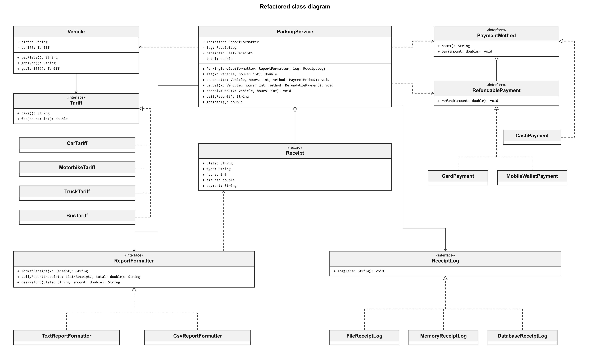

Question 1

The actors are the tariffs team, the payment team, the people asking for reports and the IT team managing storage.

Question 2

SRP: ParkingGarage, lines 12-50. It calculates fees, handles payments, formats reports and saves receipts.

OCP: ParkingGarage, lines 13-17. Adding a vehicle type requires changing the switch.

LSP: CashPayment, lines 11-12. Its refund method throws an exception instead of doing the refund required by PaymentMethod.

ISP: PaymentMethod, lines 4-6, and CashPayment, lines 11-12. CashPayment has to implement refund even though the machine cannot refund cash.

DIP: ParkingGarage, lines 9 and 30. It creates and uses FileLogger directly.

Question 3

BUS: change ParkingGarage and Main.

Mobile wallet: add a new payment class and change Main. PaymentMethod already has pay and refund.

Database logging: change ParkingGarage.

CSV report: change ParkingGarage.

Question 4

CashPayment.refund throws UnsupportedOperationException, so the program stops. This breaks LSP because cash cannot support the refund required by PaymentMethod.

Question 5

No. We can test the fee alone, but checkout always uses FileLogger and writes a file.

Question 6

Question 7

The new classes are in parking.refactored. Fee calculation, payments, reports and logging have separate classes.

Question 8

No. cancel requires RefundablePayment, and CashPayment does not implement it. The compiler gives an error.

Question 9

MemoryReceiptLog is the test double. It stores the receipts in a list instead of writing a file.

Question 10

BUS: add BusTariff and change Main.

Mobile wallet: add MobileWalletPayment and change Main.

Database logging: add DatabaseReceiptLog and change Main.

CSV report: add CsvReportFormatter and change Main.
