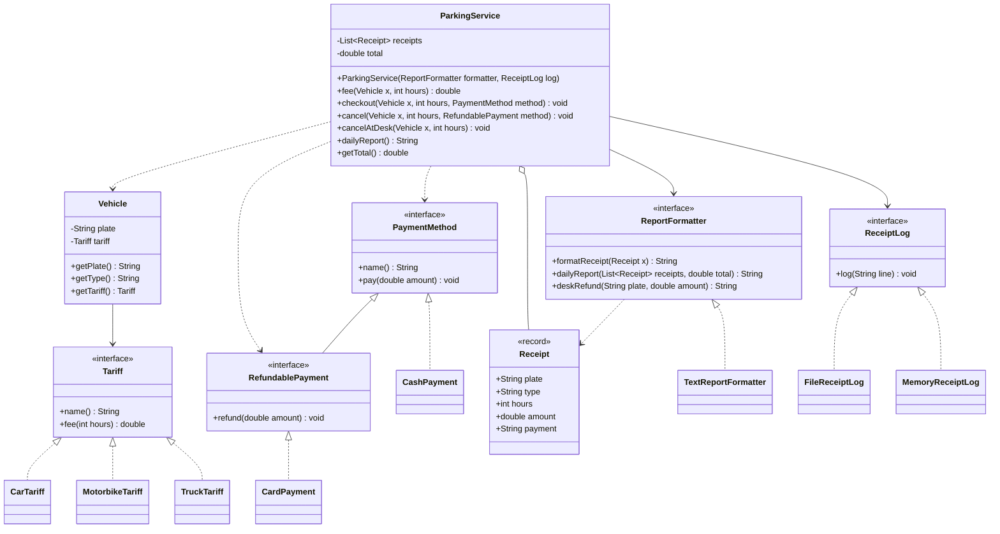

# Refactored class diagram

CashPayment has no refund operation. A cash refund is handled through cancelAtDesk. The log interface belongs to the parking package, so storage implementations depend on the business contract.
